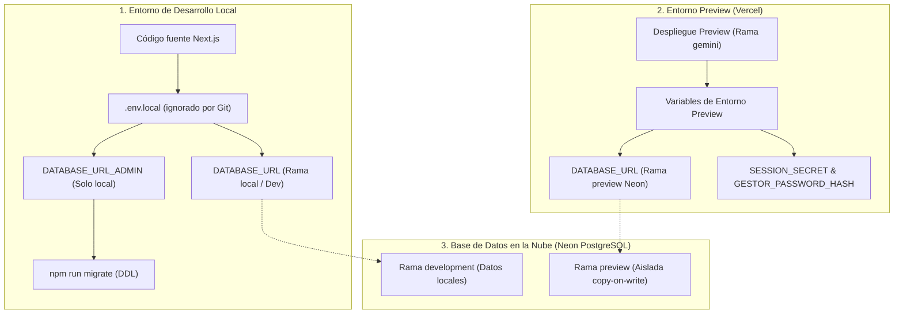

# Guía de Gestión y Custodia de Secretos (Zero-Knowledge)

Este documento detalla el ciclo de vida, la finalidad, el alcance por entorno y el protocolo de rotación y contingencia para todos los secretos técnicos del proyecto, en cumplimiento estricto de los requisitos **SEG-01** (secretos fuera de Git), **SEG-02** (secretos ausentes en cliente), **SEG-04** (mínimo privilegio) y **SEG-06** (separación de entornos).

> **Aviso de Seguridad:** Este documento **no contiene contraseñas, hashes privados ni cadenas de conexión reales**. Todos los valores sensibles son custodiados de manera soberana por el usuario en su gestor de contraseñas **Bitwarden** y configurados de forma privada en `.env.local` y en el panel web de Vercel.

---

## 1. Inventario y Clasificación de Secretos

| Nombre del Secreto | Finalidad Principal | Dónde se Usa | Entornos Requeridos | Dónde se Custodia | Nivel de Privilegio |
| :--- | :--- | :--- | :--- | :--- | :--- |
| `DATABASE_URL` | Conexión en tiempo de ejecución para persistencia de riesgos en PostgreSQL. | Backend Next.js (`lib/db.ts` / Route Handlers) | • **Development** • **Preview** | Bitwarden | **Mínimo Privilegio (DML)**: Rol `app_riesgos` (solo SELECT, INSERT, UPDATE, DELETE). Sin permisos DDL. |
| `DATABASE_URL_ADMIN` | Ejecución de migraciones DDL (`db/01_crear_tabla_riesgos.sql`). | Script local de migración (`scripts/migrar.ts`) | • **Development (Local)** | Bitwarden | **Administrador DDL**: Rol `admin_riesgos`. **NUNCA** se configura en Vercel. |
| `SESSION_SECRET` | Firma criptográfica de cookies de sesión `HttpOnly` (HMAC-SHA256). | Backend de autenticación (`lib/auth.ts`, `app/api/auth/*`) | • **Development** • **Preview** | Bitwarden | Secreto interno de servidor (mínimo 32 caracteres pseudoaleatorios). |
| `GESTOR_PASSWORD_HASH` | Verificación de acceso para el perfil único «gestor» sin exponer contraseña en claro. | Backend de autenticación (`lib/auth.ts`, `app/api/auth/login`) | • **Development** • **Preview** | Bitwarden | Hash determinista PBKDF2 (SHA-512) con sal. No almacena texto en claro. |
| `ADMIN_API_KEY` | Credencial complementaria para autorización de scripts y pruebas automatizadas. | Cabeceras HTTP de peticiones API (`Authorization: Bearer`) | • **Development** • **Preview** | Bitwarden | Token opaco de autorización administrativa en servidor. |

---

## 2. Separación de Entornos y Aislamiento (SEG-06)

El proyecto mantiene una segregación formal entre el entorno de desarrollo local y el entorno de preproducción desplegado en Vercel:

### Aislamiento con Ramas en Neon (Vercel Marketplace)
Neon utiliza almacenamiento desacoplado de computación con capacidades de ramificación instantánea (*branching* mediante *copy-on-write*):
* **Rama `development` (Local):** Utilizada durante el desarrollo iterativo y las pruebas de desarrollo.
* **Rama `preview` (Despliegues en Vercel):** Cada despliegue de Preview puede vincularse a una rama aislada de Neon que contiene una instantánea independiente de las tablas y registros. Las mutaciones realizadas en Preview **no contaminan** la base de desarrollo ni destruyen datos de pruebas.
* **Configuración en Vercel:** Las variables se asignan explícitamente al ámbito **Preview** en `Project Settings -> Environment Variables`. No se utiliza la bandera de producción `--prod`.

---

## 3. Protocolo de Rotación y Gestión de Incidentes

Si alguna credencial fuese expuesta accidentalmente (por ejemplo, en un commit o captura de pantalla), debe aplicarse el siguiente procedimiento de emergencia:

### Paso 1: Revocación Inmediata
1. **Credenciales de Base de Datos (`DATABASE_URL` / `DATABASE_URL_ADMIN`):**
   * Acceder a la consola de Neon y restablecer la contraseña del rol comprometido (`ALTER ROLE app_riesgos WITH PASSWORD 'nuevo_password';`) o regenerar el endpoint de conexión.
2. **Secreto de Sesión (`SESSION_SECRET`):**
   * Generar una nueva cadena de 32+ caracteres en el generador de Bitwarden. Su cambio invalida instantáneamente todas las cookies de sesión activas existentes.
3. **Contraseña del Gestor (`GESTOR_PASSWORD_HASH`):**
   * Generar una nueva contraseña en Bitwarden y computar su hash mediante `node --experimental-strip-types scripts/generar-hash-gestor.ts <nueva_contraseña>`.

### Paso 2: Actualización de Variables
1. Actualizar el archivo local `.env.local` (asegurándose de que permanece ignorado por Git).
2. Actualizar el valor en el panel de Vercel (`Settings -> Environment Variables`) para el entorno **Preview**.
3. Re-desplegar la aplicación en Vercel para que las nuevas variables surtan efecto.

### Paso 3: Registro Obligatorio en `docs/incidencias.md`
En cumplimiento de las normas de la práctica (*"Si exponéis una credencial por error: revocadla o cambiadla de inmediato y anotadlo en docs/incidencias.md"*), debe registrarse el suceso indicando:
* Fecha y hora del incidente.
* Secreto afectado.
* Causa de la exposición.
* Medidas de mitigación inmediatas adoptadas (revocación y rotación).
* Evidencia de no reutilización de la credencial comprometida.
